# Mid-Project-Jarkom-5

# Mid-Project Jarkom - Smart City Surabaya (Kelompok 5)

| Nama | NRP |
|---|---|
| Aura Syahzanani A. | 5027251123 |
| Danish Faeyza | 5027251028 |
| Naoval James O. | 5027251092 |

Pembagian Tugas :
- Perancangan Topologi : dikerjakan bersama.
- Perhitungan dan Tabel Subnetting VLSM & CIDR, Static Routing : Aura Syahzanani A.
- DHCP & NAT : Danish Faeyza
- Tunnel GRE, Dynamic Routing OSPF, Layanan aplikasi smart city : Naoval James O.

---

## 1. Topologi dan Pemilihan Skema


**Skema yang dipilih: VLSM** 

Alasan:
- Ukuran LAN sangat bervariasi (20 sampai 11.000 host), sehingga VLSM menyesuaikan ukuran subnet dengan kebutuhan dan tidak membuang alamat.
- Pemakaian ruang alamat VLSM 94,23% (muat di satu /16), dibanding CIDR 23,56% (butuh /14).
- Hasil VLSM sama dengan yang dipakai saat UTS, sehingga mudah ditelusuri dan direvisi.
- Kekurangan: tidak ada route summarization, jadi static route di R-PUSAT lebih banyak. Ini dibahas di bagian konfigurasi.

### Alamat dasar
- Alamat dasar kelompok: **10.40.0.0/13** (oktet ke-2 = 8 x 5).
- Alamat tambahan: link R-PUSAT ke R-ISP `203.0.113.20/30`, server internet `8.8.8.0/24`, tunnel GRE `192.168.5.0/30`.

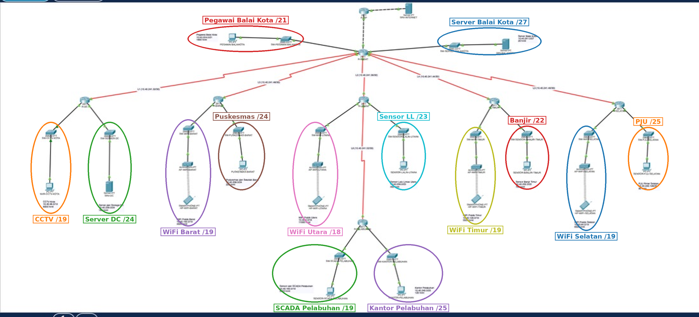

## 2. Penjelasan Desain Topologi

Backbone mengikuti Gambar 1 (L1-L6). Desain tiap lokasi:

| Lokasi | Switch | Perangkat | Media | Tambahan port router | Alasan |
|---|---|---|---|---|---|
| Balai Kota | 2× Cisco 2960-24TT: `SW-PEGAWAI-BALAIKOTA`, `SW-SERVER-BALAIKOTA` | Router `R-PUSAT` (2911), `PEGAWAI-BALAIKOTA` (PC), `SRV-BALAIKOTA` (server) | UTP straight-through Gi0/1 dan Gi0/2 ke switch; UTP cross-over Gi0/0 ke `R-ISP`; 5 kabel serial (L1–L5) | 3× HWIC-2T (Se0/0/0–Se0/2/1, 6 port serial, 5 terpakai) | Pusat backbone: 5 link serial (L1–L5) ke DC, Utara, Selatan, Timur, Barat. 2911 hanya punya 3 port Gi bawaan (ISP, LAN Pegawai /21, LAN Server /27), jadi butuh 3 HWIC-2T. |
| Command Center (DC) | 2× 2960-24TT: `SW-CCTV-KOTA`, `SW-SERVER-DC` | Router `R-DC` (2911), `NVR-CCTV-KOTA` (PC), `SRV-DC` (server) | UTP straight-through Gi0/0 dan Gi0/1 ke switch; 2 kabel serial (L1 ke R-PUSAT, L7 ke R-UTARA) | 1× HWIC-2T (Se0/0/0 untuk L1, Se0/0/1 untuk L7; kedua port terpakai) | Dua link backbone: L1 ke R-PUSAT dan L7 ke R-UTARA sebagai jalur cadangan OSPF, jadi butuh 2 port serial. LAN CCTV /19 dan LAN Server-Storage /24 memakai Gi0/0 dan Gi0/1 bawaan, sehingga cukup 1 HWIC-2T. |
| Surabaya Barat | 2× 2960-24TT: `SW-WIFI-BARAT`, `SW-PUSKESMAS-BARAT` | Router `R-BARAT` (2911), `AP-WIFI-BARAT`, `HP-WIFI-BARAT` (smartphone, via WiFi), `PUSKESMAS-BARAT` (PC) | UTP straight-through Gi0/0 dan Gi0/1 ke switch, switch ke AP/PC; 1 kabel serial (L5); WiFi untuk HP | 1× HWIC-2T (Se0/0/0 terpakai, Se0/0/1 cadangan) | Hanya 1 link backbone (L5). Dua LAN (WiFi Publik /19, Puskesmas-Sekolah /24) memakai Gi0/0 dan Gi0/1 bawaan. |
| Surabaya Utara | 2× 2960-24TT: `SW-WIFI-UTARA`, `SW-SENSOR-LALIN-UTARA` | Router `R-UTARA` (2911), `AP-WIFI-UTARA`, `HP-WIFI-UTARA` (smartphone, via WiFi), `SENSOR-LALIN-UTARA` (PC) | UTP straight-through Gi0/0 dan Gi0/1 ke switch, switch ke AP/PC; 3 kabel serial (L2 ke Pusat, L6 ke Pelabuhan, L7 ke DC); WiFi untuk HP | 2× HWIC-2T (4 port serial): Se0/0/0 untuk L2, Se0/0/1 untuk L6, Se0/1/0 untuk L7, Se0/1/1 cadangan | Utara jadi titik transit: L2 ke Pusat, L6 ke Pelabuhan, dan L7 ke DC, sehingga butuh 3 port serial. 1 HWIC-2T hanya punya 2 port, jadi dipasang 2 modul. |
| Surabaya Timur | 2× 2960-24TT: `SW-WIFI-TIMUR`, `SW-SENSOR-BANJIR-TIMUR` | Router `R-TIMUR` (2911), `AP-WIFI-TIMUR`, `HP-WIFI-TIMUR` (smartphone, via WiFi), `SENSOR-BANJIR-TIMUR` (PC) | UTP straight-through Gi0/0 dan Gi0/1 ke switch, switch ke AP/PC; 1 kabel serial (L4); WiFi untuk HP | 1× HWIC-2T (Se0/0/0 terpakai, Se0/0/1 cadangan) | Hanya 1 link backbone (L4). LAN WiFi Publik /19 dan Sensor Banjir /22 memakai Gi bawaan. |
| Surabaya Selatan | 2× 2960-24TT: `SW-WIFI-SELATAN`, `SW-PJU-SELATAN` | Router `R-SELATAN` (2911), `AP-WIFI-SELATAN`, `HP-WIFI-SELATAN` (smartphone, via WiFi), `SENSOR-PJU-SELATAN` (PC) | UTP straight-through Gi0/0 dan Gi0/1 ke switch, switch ke AP/PC; 1 kabel serial (L3); WiFi untuk HP | 1× HWIC-2T (Se0/0/0 terpakai, Se0/0/1 cadangan) | Hanya 1 link backbone (L3). LAN WiFi Publik /19 dan PJU Pintar /25 memakai Gi bawaan. |
| Pelabuhan | 2× 2960-24TT: `SW-SCADA-PELABUHAN`, `SW-KANTOR-PELABUHAN` | Router `R-PELABUHAN` (2911), `SENSOR-SCADA-PELABUHAN` (PC), `KANTOR-PELABUHAN` (PC) | UTP straight-through Gi0/0 dan Gi0/1 ke switch, switch ke PC; 1 kabel serial (L6 ke `R-UTARA`) | 1× HWIC-2T (Se0/0/0 terpakai, Se0/0/1 cadangan) | Terhubung ke backbone lewat Utara (L6). LAN SCADA /19 dan Kantor /25 memakai Gi bawaan. Di file juga ada GRE tunnel (192.168.5.0/30) ke `R-PUSAT`. |


Penamaan perangkat mengikuti pola `jenis-fungsi-lokasi`: router `R-<LOKASI>` (misalnya `R-PUSAT`), switch `SW-<LAN>` (misalnya `SW-PEGAWAI-BALAIKOTA`, `SW-CCTV-KOTA`), access point `AP-WIFI-<LOKASI>`, dan perangkat akhir sesuai fungsinya (`PEGAWAI-BALAIKOTA`, `NVR-CCTV-KOTA`, `SENSOR-PJU-SELATAN`, `HP-WIFI-TIMUR`, `SRV-DC`). Setiap LAN diberi label berisi nama subnet, Network ID/prefix, dan jumlah host (contoh: "Pegawai Balai Kota / 10.40.224.0/21 / 1800 host"). Setiap link backbone juga diberi label nomor link dan subnetnya, misalnya "L1 (10.40.241.32/30)".

Satu perangkat perwakilan dipasang di setiap LAN (sesuai soal), sedangkan ukuran subnet tetap dihitung dari jumlah host penuh. Sensor IoT diwakili PC karena yang diuji adalah konektivitas IP (DHCP, ping, FTP), bukan fungsi sensornya. LAN WiFi Publik memakai access point dengan SSID per wilayah dan smartphone sebagai klien, supaya media wireless ikut teruji.

## 3. Tabel Subnetting

### 3.1 Kebutuhan subnet

| LAN | Router | Host | Prefix | Blok | Subnet mask |
|---|---|---|---|---|---|
| WiFi Publik Utara | R-UTARA | 11.000 | /18 | 16.384 | 255.255.192.0 |
| WiFi Publik Selatan | R-SELATAN | 6.500 | /19 | 8.192 | 255.255.224.0 |
| CCTV Kota | R-DC | 6.000 | /19 | 8.192 | 255.255.224.0 |
| WiFi Publik Timur | R-TIMUR | 5.500 | /19 | 8.192 | 255.255.224.0 |
| Sensor dan SCADA Pelabuhan | R-PELABUHAN | 5.000 | /19 | 8.192 | 255.255.224.0 |
| WiFi Publik Barat | R-BARAT | 4.500 | /19 | 8.192 | 255.255.224.0 |
| Pegawai Balai Kota | R-PUSAT | 1.800 | /21 | 2.048 | 255.255.248.0 |
| Sensor Banjir Timur | R-TIMUR | 700 | /22 | 1.024 | 255.255.252.0 |
| Sensor Lalu Lintas Utara | R-UTARA | 450 | /23 | 512 | 255.255.254.0 |
| Puskesmas dan Sekolah Barat | R-BARAT | 220 | /24 | 256 | 255.255.255.0 |
| Server dan Storage DC | R-DC | 180 | /24 | 256 | 255.255.255.0 |
| Kantor Pelabuhan | R-PELABUHAN | 120 | /25 | 128 | 255.255.255.128 |
| PJU Pintar Selatan | R-SELATAN | 90 | /25 | 128 | 255.255.255.128 |
| Server Balai Kota | R-PUSAT | 20 | /27 | 32 | 255.255.255.224 |

### 3.2 Tabel VLSM (10.40.0.0/16)

| Subnet | Network ID/Prefix | Rentang host | Broadcast | Gateway |
|---|---|---|---|---|
| WiFi Publik Utara | 10.40.0.0/18 | 10.40.0.1 - 10.40.63.254 | 10.40.63.255 | 10.40.0.1 |
| WiFi Publik Selatan | 10.40.64.0/19 | 10.40.64.1 - 10.40.95.254 | 10.40.95.255 | 10.40.64.1 |
| CCTV Kota | 10.40.96.0/19 | 10.40.96.1 - 10.40.127.254 | 10.40.127.255 | 10.40.96.1 |
| WiFi Publik Timur | 10.40.128.0/19 | 10.40.128.1 - 10.40.159.254 | 10.40.159.255 | 10.40.128.1 |
| Sensor dan SCADA Pelabuhan | 10.40.160.0/19 | 10.40.160.1 - 10.40.191.254 | 10.40.191.255 | 10.40.160.1 |
| WiFi Publik Barat | 10.40.192.0/19 | 10.40.192.1 - 10.40.223.254 | 10.40.223.255 | 10.40.192.1 |
| Pegawai Balai Kota | 10.40.224.0/21 | 10.40.224.1 - 10.40.231.254 | 10.40.231.255 | 10.40.224.1 |
| Sensor Banjir Timur | 10.40.232.0/22 | 10.40.232.1 - 10.40.235.254 | 10.40.235.255 | 10.40.232.1 |
| Sensor Lalu Lintas Utara | 10.40.236.0/23 | 10.40.236.1 - 10.40.237.254 | 10.40.237.255 | 10.40.236.1 |
| Puskesmas dan Sekolah Barat | 10.40.238.0/24 | 10.40.238.1 - 10.40.238.254 | 10.40.238.255 | 10.40.238.1 |
| Server dan Storage DC | 10.40.239.0/24 | 10.40.239.1 - 10.40.239.254 | 10.40.239.255 | 10.40.239.1 |
| Kantor Pelabuhan | 10.40.240.0/25 | 10.40.240.1 - 10.40.240.126 | 10.40.240.127 | 10.40.240.1 |
| PJU Pintar Selatan | 10.40.240.128/25 | 10.40.240.129 - 10.40.240.254 | 10.40.240.255 | 10.40.240.129 |
| Server Balai Kota | 10.40.241.0/27 | 10.40.241.1 - 10.40.241.30 | 10.40.241.31 | 10.40.241.1 |
| L1 (PUSAT - DC) | 10.40.241.32/30 | .33 - .34 | 10.40.241.35 | - |
| L2 (PUSAT - UTARA) | 10.40.241.36/30 | .37 - .38 | 10.40.241.39 | - |
| L3 (PUSAT - SELATAN) | 10.40.241.40/30 | .41 - .42 | 10.40.241.43 | - |
| L4 (PUSAT - TIMUR) | 10.40.241.44/30 | .45 - .46 | 10.40.241.47 | - |
| L5 (PUSAT - BARAT) | 10.40.241.48/30 | .49 - .50 | 10.40.241.51 | - |
| L6 (UTARA - PELABUHAN) | 10.40.241.52/30 | .53 - .54 | 10.40.241.55 | - |
| L7 (DC - UTARA, OSPF) | 10.40.241.56/30 | .57 - .58 | 10.40.241.59 | - |

### 3.3 Pohon penggabungan CIDR

| Router | Anggota | Jumlah alamat | Blok | Supernet |
|---|---|---|---|---|
| R-PUSAT | Pegawai 2048 + Server BK 32 + L1-L5 20 | 2.100 | 4.096 (/20) | 10.42.0.0/20 |
| R-DC | CCTV 8192 + Server DC 256 | 8.448 | 16.384 (/18) | 10.41.0.0/18 |
| R-BARAT | WiFi 8192 + Puskesmas 256 | 8.448 | 16.384 (/18) | 10.41.64.0/18 |
| R-TIMUR | WiFi 8192 + Banjir 1024 | 9.216 | 16.384 (/18) | 10.41.128.0/18 |
| R-SELATAN | WiFi 8192 + PJU 128 | 8.320 | 16.384 (/18) | 10.41.192.0/18 |
| R-PELABUHAN | SCADA 8192 + Kantor 128 | 8.320 | 16.384 (/18) | 10.40.64.0/18 |
| R-UTARA | WiFi 16384 + Sensor LL 512 + L6 4 + R-PELABUHAN 16384 | 33.284 | 65.536 (/16) | 10.40.0.0/16 |
| **Root** | R-UTARA + 4 x 16384 + R-PUSAT 4096 | 135.168 | 262.144 (/14) | 10.40.0.0/14 |

### 3.4 Tabel alokasi CIDR

| Subnet | Router | Network ID/Prefix | Rentang host | Broadcast |
|---|---|---|---|---|
| WiFi Publik Utara | R-UTARA | 10.40.0.0/18 | 10.40.0.1 - 10.40.63.254 | 10.40.63.255 |
| Sensor dan SCADA Pelabuhan | R-PELABUHAN | 10.40.64.0/19 | 10.40.64.1 - 10.40.95.254 | 10.40.95.255 |
| Kantor Pelabuhan | R-PELABUHAN | 10.40.96.0/25 | 10.40.96.1 - 10.40.96.126 | 10.40.96.127 |
| Sensor Lalu Lintas Utara | R-UTARA | 10.40.128.0/23 | 10.40.128.1 - 10.40.129.254 | 10.40.129.255 |
| L6 | R-UTARA | 10.40.130.0/30 | .1 - .2 | 10.40.130.3 |
| CCTV Kota | R-DC | 10.41.0.0/19 | 10.41.0.1 - 10.41.31.254 | 10.41.31.255 |
| Server dan Storage DC | R-DC | 10.41.32.0/24 | 10.41.32.1 - 10.41.32.254 | 10.41.32.255 |
| WiFi Publik Barat | R-BARAT | 10.41.64.0/19 | 10.41.64.1 - 10.41.95.254 | 10.41.95.255 |
| Puskesmas dan Sekolah Barat | R-BARAT | 10.41.96.0/24 | 10.41.96.1 - 10.41.96.254 | 10.41.96.255 |
| WiFi Publik Timur | R-TIMUR | 10.41.128.0/19 | 10.41.128.1 - 10.41.159.254 | 10.41.159.255 |
| Sensor Banjir Timur | R-TIMUR | 10.41.160.0/22 | 10.41.160.1 - 10.41.163.254 | 10.41.163.255 |
| WiFi Publik Selatan | R-SELATAN | 10.41.192.0/19 | 10.41.192.1 - 10.41.223.254 | 10.41.223.255 |
| PJU Pintar Selatan | R-SELATAN | 10.41.224.0/25 | 10.41.224.1 - 10.41.224.126 | 10.41.224.127 |
| Pegawai Balai Kota | R-PUSAT | 10.42.0.0/21 | 10.42.0.1 - 10.42.7.254 | 10.42.7.255 |
| Server Balai Kota | R-PUSAT | 10.42.8.0/27 | 10.42.8.1 - 10.42.8.30 | 10.42.8.31 |
| L1 - L5 | R-PUSAT | 10.42.8.32/30, .36, .40, .44, .48 | - | - |

### 3.5 Efisiensi

| | VLSM | CIDR |
|---|---|---|
| Prefix terkecil | /16 | /14 |
| Total alamat | 65.536 | 262.144 |
| Terpakai | 61.752 | 61.752 |
| Pemakaian | 94,23% | 23,56% |
| Terbuang | 3.784 | 200.392 |

VLSM lebih efisien dengan selisih 70,67 poin persen. CIDR mengimbangi dengan route summarization per router.

### 3.6 Tabel revisi (UTS vs perbaikan)

| No | Subnet / bagian | Jawaban UTS | Perbaikan | Alasan |
|---|---|---|---|---|
| 1 | VLSM WiFi Barat (broadcast) | 10.40.233.255 | 10.40.223.255 | 192 + 32 = 224, dikurangi 1 |
| 2 | VLSM WiFi Timur (akhir host) | 10.46.159.254 | 10.40.159.254 | Salah tulis oktet ke-2 |
| 3 | VLSM Sensor Banjir (awal host) | 10.40.231.1 | 10.40.232.1 | Network ID 232.0 + 1 |
| 4 | VLSM link L1-L6 | Tidak ada | 6 x /30 di 10.40.241.32 - .52 | Tiap link butuh /30 |
| 5 | CIDR R-BARAT | Puskesmas 216 | 256 | Blok /24 = 256 |
| 6 | CIDR R-SELATAN | PJU tidak tertulis | WiFi 8192 + PJU 128 | Anggota tidak lengkap |
| 7 | CIDR Sensor LL Utara | Di R-PELABUHAN, 10.40.236.0/23 | R-UTARA, 10.40.128.0/23 | Terhubung ke R-UTARA |
| 8 | CIDR SCADA dan Kantor | 10.40.160.0/19 dan 10.40.240.0/25 | 10.40.64.0/19 dan 10.40.96.0/25 | Harus satu blok /18 agar bisa digabung |
| 9 | CIDR Kantor (broadcast) | 10.40.239.255 | 10.40.96.127 | /25: network + 127 |
| 10 | CIDR PJU (broadcast) | 10.41.224.255 | 10.41.224.127 | /25: network + 127 (blok 128 alamat) |
| 11 | CIDR link L1-L6 | Hanya jumlah alamat | Network ID nyata | Dipakai di Packet Tracer |
| 12 | Selisih efisiensi | 71% | 70,67 poin persen | 94,23% - 23,56% |

## 4. Penjelasan Konfigurasi

### 4.1 Static routing

Skema VLSM tidak punya route summarization, sehingga setiap LAN harus didaftarkan satu per satu. Pola routingnya:

- **Router ujung** (`R-DC`, `R-BARAT`, `R-TIMUR`, `R-SELATAN`) hanya punya satu default route ke `R-PUSAT` lewat link /30 masing-masing, karena semua tujuan (LAN lain dan internet) ada di balik R-PUSAT.
- **R-PELABUHAN** punya default route ke `R-UTARA` (L6), karena Pelabuhan terhubung ke backbone lewat Utara.
- **R-UTARA** punya default route ke `R-PUSAT` (L2) dan dua static route ke LAN Pelabuhan lewat L6.
- **R-PUSAT** punya default route ke `R-ISP` dan satu static route untuk tiap LAN di bawahnya.

| Router | Tujuan | Next hop | Keterangan |
|---|---|---|---|
| R-DC | 0.0.0.0/0 | 10.40.241.33 | R-PUSAT (L1) |
| R-BARAT | 0.0.0.0/0 | 10.40.241.49 | R-PUSAT (L5) |
| R-TIMUR | 0.0.0.0/0 | 10.40.241.45 | R-PUSAT (L4) |
| R-SELATAN | 0.0.0.0/0 | 10.40.241.41 | R-PUSAT (L3) |
| R-UTARA | 0.0.0.0/0 | 10.40.241.37 | R-PUSAT (L2) |
| R-UTARA | 10.40.160.0/19, 10.40.240.0/25 | 10.40.241.54 | LAN Pelabuhan lewat L6 |
| R-PELABUHAN | 0.0.0.0/0 | 10.40.241.53 | R-UTARA (L6) |
| R-PELABUHAN | 10.40.224.0/21, 10.40.241.0/27 | 192.168.5.1 | LAN Balai Kota lewat tunnel GRE (lihat 4.4) |
| R-PUSAT | 0.0.0.0/0 | 203.0.113.22 | R-ISP |
| R-PUSAT | 10.40.96.0/19, 10.40.239.0/24 | 10.40.241.34 | R-DC |
| R-PUSAT | 10.40.0.0/18, 10.40.236.0/23, 10.40.241.52/30 | 10.40.241.38 | R-UTARA (WiFi Utara, Sensor Lalu Lintas, dan link L6) |
| R-PUSAT | 10.40.64.0/19, 10.40.240.128/25 | 10.40.241.42 | R-SELATAN |
| R-PUSAT | 10.40.128.0/19, 10.40.232.0/22 | 10.40.241.46 | R-TIMUR |
| R-PUSAT | 10.40.192.0/19, 10.40.238.0/24 | 10.40.241.50 | R-BARAT |
| R-PUSAT | 10.40.160.0/19, 10.40.240.0/25 | 192.168.5.2 | LAN Pelabuhan lewat tunnel GRE (lihat 4.4) |

Tabel di atas adalah routing static penuh seperti di `K5_VLSM.pkt`. Setelah OSPF diaktifkan (`K5_VLSM_OSPF.pkt`, lihat 4.5), hampir semua route di atas diganti OSPF. Yang tetap static hanya: default route R-PUSAT ke R-ISP, dua route R-PUSAT ke LAN Pelabuhan lewat tunnel, dan dua route R-PELABUHAN ke LAN Balai Kota lewat tunnel.

R-PUSAT memakai 14 route (1 default dan 13 static) pada versi static penuh. Dengan CIDR cukup sekitar 5 route supernet (satu per router), tetapi VLSM dipilih karena pemakaian alamatnya lebih efisien.

Route `10.40.241.52/30` di R-PUSAT sengaja ditambahkan agar alamat ujung tunnel `10.40.241.54` (Se0/0/0 R-PELABUHAN) bisa dijangkau lewat R-UTARA.

```
! R-PUSAT
ip route 0.0.0.0 0.0.0.0 203.0.113.22
ip route 10.40.96.0 255.255.224.0 10.40.241.34
ip route 10.40.239.0 255.255.255.0 10.40.241.34
ip route 10.40.0.0 255.255.192.0 10.40.241.38
ip route 10.40.236.0 255.255.254.0 10.40.241.38
ip route 10.40.241.52 255.255.255.252 10.40.241.38
ip route 10.40.64.0 255.255.224.0 10.40.241.42
ip route 10.40.240.128 255.255.255.128 10.40.241.42
ip route 10.40.128.0 255.255.224.0 10.40.241.46
ip route 10.40.232.0 255.255.252.0 10.40.241.46
ip route 10.40.192.0 255.255.224.0 10.40.241.50
ip route 10.40.238.0 255.255.255.0 10.40.241.50
ip route 10.40.160.0 255.255.224.0 192.168.5.2
ip route 10.40.240.0 255.255.255.128 192.168.5.2

! R-UTARA
ip route 0.0.0.0 0.0.0.0 10.40.241.37
ip route 10.40.160.0 255.255.224.0 10.40.241.54
ip route 10.40.240.0 255.255.255.128 10.40.241.54

! R-PELABUHAN
ip route 0.0.0.0 0.0.0.0 10.40.241.53
ip route 10.40.224.0 255.255.248.0 192.168.5.1
ip route 10.40.241.0 255.255.255.224 192.168.5.1

! R-DC (R-BARAT, R-TIMUR, R-SELATAN sama, next hop sesuai tabel)
ip route 0.0.0.0 0.0.0.0 10.40.241.33
```

### 4.2 DHCP

Setiap router menjadi DHCP server untuk LAN yang terhubung langsung ke dirinya. Tiap pool memakai gateway = host pertama LAN, DNS server `10.40.239.10` (SRV-DC), dan 10 alamat pertama dikecualikan (`excluded-address`) untuk gateway dan perangkat statis seperti AP.

| Router | Pool | Network | Gateway | Excluded |
|---|---|---|---|---|
| R-PUSAT | PEGAWAI-BALAIKOTA | 10.40.224.0/21 | 10.40.224.1 | 10.40.224.1 - .10 |
| R-BARAT | WIFI-PUBLIK-BARAT | 10.40.192.0/19 | 10.40.192.1 | 10.40.192.1 - .10 |
| R-BARAT | PUSKESMAS-SEKOLAH-BARAT | 10.40.238.0/24 | 10.40.238.1 | 10.40.238.1 - .10 |
| R-UTARA | WIFI-PUBLIK-UTARA | 10.40.0.0/18 | 10.40.0.1 | 10.40.0.1 - .10 |
| R-UTARA | SENSOR-LALIN-UTARA | 10.40.236.0/23 | 10.40.236.1 | 10.40.236.1 - .10 |
| R-TIMUR | WIFI-PUBLIK-TIMUR | 10.40.128.0/19 | 10.40.128.1 | 10.40.128.1 - .10 |
| R-TIMUR | SENSOR-BANJIR-TIMUR | 10.40.232.0/22 | 10.40.232.1 | 10.40.232.1 - .10 |
| R-SELATAN | WIFI-PUBLIK-SELATAN | 10.40.64.0/19 | 10.40.64.1 | 10.40.64.1 - .10 |
| R-SELATAN | PJU-PINTAR-SELATAN | 10.40.240.128/25 | 10.40.240.129 | 10.40.240.129 - .138 |
| R-PELABUHAN | SENSOR-SCADA-PELABUHAN | 10.40.160.0/19 | 10.40.160.1 | 10.40.160.1 - .10 |
| R-PELABUHAN | KANTOR-PELABUHAN | 10.40.240.0/25 | 10.40.240.1 | 10.40.240.1 - .10 |

Contoh konfigurasi (R-PUSAT):

```
ip dhcp excluded-address 10.40.224.1 10.40.224.10
ip dhcp pool PEGAWAI-BALAIKOTA
 network 10.40.224.0 255.255.248.0
 default-router 10.40.224.1
 dns-server 10.40.239.10
```

**CCTV Kota** berbeda: `R-DC` tidak punya pool. DHCP Discover berupa broadcast dan tidak diteruskan router, sehingga `Gi0/0` R-DC memakai `ip helper-address` untuk mengubahnya menjadi unicast ke DHCP server di SRV-DC. Pool `CCTV-KOTA` (10.40.96.0/19, gateway 10.40.96.1, DNS 10.40.239.10, mulai 10.40.96.11, maksimal 8.000 pengguna) dibuat di SRV-DC.

```
! R-DC
interface GigabitEthernet0/0
 description LAN-CCTV-KOTA
 ip address 10.40.96.1 255.255.224.0
 ip helper-address 10.40.239.10
```

Server (SRV-DC `10.40.239.10`, SRV-BALAIKOTA `10.40.241.10`) memakai IP statis dengan gateway host pertama LAN-nya, bukan DHCP.

### 4.3 NAT

PAT (NAT overload) dipasang di `R-PUSAT`, satu-satunya router yang terhubung ke ISP. Semua alamat internal `10.40.0.0/16` diterjemahkan ke alamat `Gi0/0` (`203.0.113.21`) sehingga seluruh kota keluar ke internet dengan satu alamat publik. Antarmuka LAN dan serial ditandai `ip nat inside`, sedangkan `Gi0/0` ke R-ISP ditandai `ip nat outside`.

```
! R-PUSAT
access-list 1 permit 10.40.0.0 0.0.255.255
ip nat inside source list 1 interface GigabitEthernet0/0 overload

interface GigabitEthernet0/0
 ip address 203.0.113.21 255.255.255.252
 ip nat outside
interface GigabitEthernet0/1
 ip nat inside
interface GigabitEthernet0/2
 ip nat inside
interface Serial0/0/0
 ip nat inside
! idem Serial0/0/1, Serial0/1/0, Serial0/1/1, Serial0/2/0
```

`R-ISP` tidak punya rute ke jaringan privat `10.40.0.0/13` (alamat privat RFC 1918 tidak dirutekan di internet). R-ISP hanya mengenal jaringan yang terhubung langsung: `203.0.113.20/30` dan `8.8.8.0/24`. Karena itu paket dari internal harus diterjemahkan dulu ke `203.0.113.21`, sehingga balasan dari server internet (`8.8.8.8`) bisa kembali ke R-PUSAT dan diterjemahkan balik.

### 4.4 Tunnel GRE

Tunnel `192.168.5.0/30` menghubungkan `R-PUSAT` (`.1`) langsung ke `R-PELABUHAN` (`.2`) sehingga keduanya terlihat bertetangga langsung, walaupun fisiknya melewati R-UTARA (L2 dan L6). Ujung tunnel memakai alamat serial masing-masing: Se0/1/0 R-PUSAT (`10.40.241.37`) dan Se0/0/0 R-PELABUHAN (`10.40.241.54`).

```
! R-PUSAT
interface Tunnel0
 ip address 192.168.5.1 255.255.255.252
 tunnel source Serial0/1/0
 tunnel destination 10.40.241.54
ip route 10.40.160.0 255.255.224.0 192.168.5.2
ip route 10.40.240.0 255.255.255.128 192.168.5.2

! R-PELABUHAN
interface Tunnel0
 ip address 192.168.5.2 255.255.255.252
 tunnel source Serial0/0/0
 tunnel destination 10.40.241.37
ip route 10.40.224.0 255.255.248.0 192.168.5.1
ip route 10.40.241.0 255.255.255.224 192.168.5.1
```

**Alasan router memilih tunnel.** Static route menuju LAN Pelabuhan (di R-PUSAT) dan LAN Balai Kota (di R-PELABUHAN) menunjuk next hop alamat tunnel (`192.168.5.x`), bukan alamat L2/L6. Jadi kedua router mengirim paket ke LAN tersebut lewat `Tunnel0`, dan R-UTARA hanya meneruskan paket GRE yang sudah dibungkus. Setelah OSPF aktif, prefix yang sama sebenarnya juga dipelajari lewat R-UTARA, tetapi static route punya administrative distance 1 sedangkan OSPF 110, sehingga route tunnel tetap yang dipilih. `show interfaces tunnel0` menampilkan `Tunnel transport MTU 1476 bytes`, karena header GRE menambah 24 byte (20 byte IP dan 4 byte GRE) pada MTU 1500.

Hasil `show interfaces tunnel0` di kedua sisi: `Tunnel0 is up, line protocol is up`, `Tunnel protocol/transport GRE/IP`, R-PUSAT `source 10.40.241.37, destination 10.40.241.54` dan R-PELABUHAN `source 10.40.241.54, destination 10.40.241.37`.

**Kenapa GRE tidak mengenkripsi.** GRE hanya melakukan encapsulation: paket asli dibungkus header IP baru (protokol 47) agar bisa dikirim lewat jaringan di antaranya. Isi paket tetap berupa teks biasa, sehingga R-UTARA atau siapa pun di jalur itu bisa membacanya. GRE juga tidak punya autentikasi atau pengecekan integritas.

**Bonus IPsec (belum dikonfigurasi di file .pkt).** Untuk enkripsi, tunnel GRE bisa dilindungi IPsec (GRE over IPsec): buat kebijakan ISAKMP/IKE, transform set (misalnya ESP-AES dan SHA), lalu terapkan `crypto map` atau tunnel protection pada kedua ujung tunnel. Dengan begitu paket GRE dienkripsi sebelum melewati R-UTARA.

### 4.5 OSPF

OSPF (process 1, area 0) dijalankan di ketujuh router (file `K5_VLSM_OSPF.pkt`). Link **L7 (R-DC - R-UTARA)** memakai `10.40.241.56/30` (R-DC `.57` sebagai DCE dengan `clock rate 2000000`, R-UTARA `.58`) dan menjadi jalur cadangan. Tanpa L7, R-DC hanya terhubung lewat L1, sehingga kalau L1 putus, DC terisolasi. Dengan L7, R-DC tetap bisa ke R-PUSAT lewat jalur `R-DC - L7 - R-UTARA - L2 - R-PUSAT`.

| Router | Router ID | Interface passive |
|---|---|---|
| R-PUSAT | 1.1.1.1 | Gi0/1, Gi0/2 |
| R-DC | 2.2.2.2 | Gi0/0, Gi0/1 |
| R-UTARA | 3.3.3.3 | Gi0/0, Gi0/1 |
| R-SELATAN | 4.4.4.4 | Gi0/0, Gi0/1 |
| R-TIMUR | 5.5.5.5 | Gi0/0, Gi0/1 |
| R-BARAT | 6.6.6.6 | Gi0/0, Gi0/1 |
| R-PELABUHAN | 7.7.7.7 | Gi0/0, Gi0/1 |

Semua router memakai satu statement `network` yang mencakup seluruh blok kelompok `10.40.0.0/16`, sehingga LAN dan link serial ikut diiklankan:

```
! R-DC (router lain sama, router-id dan interface passive sesuai tabel)
router ospf 1
 router-id 2.2.2.2
 log-adjacency-changes
 passive-interface GigabitEthernet0/0
 passive-interface GigabitEthernet0/1
 network 10.40.0.0 0.0.255.255 area 0

interface Serial0/0/1
 description L7-KE-R-UTARA
 ip address 10.40.241.57 255.255.255.252
 clock rate 2000000

! R-UTARA
interface Serial0/1/0
 description L7-KE-R-DC
 ip address 10.40.241.58 255.255.255.252

! R-PUSAT
router ospf 1
 router-id 1.1.1.1
 log-adjacency-changes
 passive-interface GigabitEthernet0/1
 passive-interface GigabitEthernet0/2
 network 10.40.0.0 0.0.255.255 area 0
 default-information originate
```

- `passive-interface` dipasang di interface LAN supaya OSPF tidak mengirim Hello ke segmen yang hanya berisi host. Adjacency hanya terbentuk di link serial antarrouter.
- `default-information originate` di R-PUSAT menyebarkan default route ke R-ISP ke semua router OSPF. Karena itu default route static di R-DC, R-BARAT, R-TIMUR, R-SELATAN, R-UTARA, dan R-PELABUHAN sudah dihapus.
- Di R-PUSAT, `Gi0/0` ke ISP tidak perlu passive karena alamatnya `203.0.113.21` berada di luar `10.40.0.0/16` dan tidak masuk statement `network`.
- Static route R-PUSAT dan R-PELABUHAN lewat tunnel dibiarkan (lihat 4.4).

**Verifikasi OSPF (di R-DC):**

- `show ip ospf neighbor` di R-PUSAT: 5 tetangga (2.2.2.2 sampai 6.6.6.6) berstatus `FULL`.
- `show ip route ospf`: 12 LAN wilayah lain berkode `O` dan `O*E2 0.0.0.0/0 via 10.40.241.33`. LAN Utara dan Pelabuhan lewat L7 (`via 10.40.241.58`) karena lebih dekat, LAN lain lewat L1 (`via 10.40.241.33`).
- `show ip route static`: kosong (static route antar-router sudah diganti OSPF).
- `show ip protocols`: `Router ID 2.2.2.2`, `Passive Interface(s): GigabitEthernet0/0, GigabitEthernet0/1`.

**Uji failover (link utama L1 diputus):**

| Tahap | Perintah | Hasil |
|---|---|---|
| Sebelum | `tracert 8.8.8.8` dari NVR-CCTV-KOTA | 10.40.96.1 → **10.40.241.33** (R-PUSAT lewat L1) → 203.0.113.22 → 8.8.8.8 |
| Putus | `ping -t 8.8.8.8` di NVR, lalu `shutdown` Se0/0/0 R-DC | `Reply ... TTL=125`, lalu **1× `Request timed out`**, lalu `Reply ... TTL=124` |
| Sesudah | `tracert 8.8.8.8` dari NVR | 10.40.96.1 → **10.40.241.58** (R-UTARA lewat L7) → **10.40.241.37** (R-PUSAT lewat L2) → 203.0.113.22 → 8.8.8.8 |
| Sesudah | `ping 10.40.241.10` dari NVR | Lost = 0 |
| Pulih | `no shutdown` Se0/0/0 R-DC | `Nbr 1.1.1.1 ... LOADING to FULL` |

TTL turun dari 125 ke 124 karena paket melewati satu router tambahan (R-UTARA). Konektivitas pulih otomatis tanpa konfigurasi ulang.

### 4.6 Layanan Smart City (domain `k5.smartcity.lab`)

Layanan dipasang di dua server dan semua klien memakai DNS `10.40.239.10` dari DHCP.

| Layanan | Server | Alamat | Konfigurasi |
|---|---|---|---|
| DNS | SRV-DC | 10.40.239.10 | DNS service aktif, 4 record A (lihat di bawah) |
| Web | SRV-BALAIKOTA | 10.40.241.10 | HTTP aktif, `index.html` menampilkan "Portal Smart City Surabaya - Kelompok 5 - Mid-Project Jarkom" |
| FTP | SRV-DC | 10.40.239.10 | FTP aktif, akun `cctv` dan `cisco` (RWDNL), file `rekaman-cctv.txt` |
| Email | SRV-BALAIKOTA | 10.40.241.10 | SMTP dan POP3 aktif, domain `k5.smartcity.lab`, akun `pegawai` dan `kantor` |

Record DNS di SRV-DC:

| Nama | Tipe | Alamat |
|---|---|---|
| `k5.smartcity.lab` | A | 10.40.241.10 |
| `www.k5.smartcity.lab` | A | 10.40.241.10 |
| `mail.k5.smartcity.lab` | A | 10.40.241.10 |
| `ftp.k5.smartcity.lab` | A | 10.40.239.10 |

Pengaturan email klien: `PEGAWAI-BALAIKOTA` memakai `pegawai@k5.smartcity.lab` dan `KANTOR-PELABUHAN` memakai `kantor@k5.smartcity.lab`, keduanya dengan server POP3 dan SMTP `mail.k5.smartcity.lab`. Di server sudah tersimpan email uji dari Pegawai Balai Kota ke Kantor Pelabuhan ("Uji Email Balai Kota ke Pelabuhan") beserta balasannya ("Balasan dari Kantor Pelabuhan"), yang membuktikan email jalan dua arah lewat tunnel dan backbone.

## 5. Bukti Pengujian

Semua pengujian dijalankan di Packet Tracer 9.0.1 pada `K5_VLSM.pkt` (soal 1–6, 8) dan `K5_VLSM_OSPF.pkt` (soal 7).

| Soal | Perangkat sumber → tujuan | Perintah | Hasil |
|---|---|---|---|
| 1 | Topologi | Tampilan Logical | Backbone L1–L6, R-ISP, SRV-INTERNET sesuai Gambar 1; nama perangkat dan 14 label LAN lengkap |
| 3 | R-PUSAT | `show ip route static` | 13 route `S` ke LAN di bawahnya + `S* 0.0.0.0/0 via 203.0.113.22` |
| 3 | R-UTARA | `show ip route static` | `10.40.160.0/19` dan `10.40.240.0/25 via 10.40.241.54`, `S* via 10.40.241.37` |
| 3 | R-DC / R-PELABUHAN | `show ip route static` | `S* via 10.40.241.33` / `S* via 10.40.241.53` |
| 3 | PEGAWAI-BALAIKOTA → SENSOR-SCADA-PELABUHAN, SENSOR-PJU-SELATAN | `ping 10.40.160.11`, `ping 10.40.240.139` | Reply (paket pertama RTO karena ARP) |
| 4 | PEGAWAI-BALAIKOTA | `ipconfig /renew`, `ipconfig /all` | IP 10.40.224.11, gateway 10.40.224.1, DNS 10.40.239.10, DHCP server 10.40.224.1 |
| 4 | NVR-CCTV-KOTA | `ipconfig /renew`, `ipconfig /all` | IP 10.40.96.11, gateway 10.40.96.1, DNS 10.40.239.10, **DHCP server 10.40.239.10 (SRV-DC)** |
| 4 | R-DC | `show running-config \| include helper` | `ip helper-address 10.40.239.10` |
| 5 | Balai Kota, DC, Pelabuhan → SRV-INTERNET | `ping 8.8.8.8` | Reply dari ketiga wilayah |
| 5 | R-ISP | `show ip route` | Hanya `8.8.8.0/24` dan `203.0.113.20/30`, tanpa rute ke 10.x |
| 5 | R-PUSAT | `show ip nat translations` / `show ip nat statistics` | Terjemahan ke 203.0.113.21 (entri ICMP hilang ±1 menit setelah ping; statistik menunjukkan hits) |
| 6 | PEGAWAI-BALAIKOTA → KANTOR-PELABUHAN | `tracert 10.40.240.11` | 10.40.224.1 → **192.168.5.2** → 10.40.240.11 |
| 6 | KANTOR-PELABUHAN → PEGAWAI-BALAIKOTA | `tracert 10.40.224.11` | 10.40.240.1 → **192.168.5.1** → 10.40.224.11 |
| 7 | R-PUSAT, R-DC, NVR | lihat 4.5 | 5 neighbor FULL, rute O/O*E2, failover lewat L7 |
| 8 | PEGAWAI-BALAIKOTA, KANTOR-PELABUHAN | `nslookup www/ftp/mail.k5.smartcity.lab` | Server 10.40.239.10 menjawab www → 10.40.241.10, ftp → 10.40.239.10, mail → 10.40.241.10 |
| 8 | 7 wilayah → nama domain | `ping www/ftp/mail.k5.smartcity.lab` | Nama diterjemahkan dan server membalas dari semua wilayah |
| 8 | PEGAWAI-BALAIKOTA, HP-WIFI-TIMUR, KANTOR-PELABUHAN | Web Browser `www.k5.smartcity.lab` | Halaman "Portal Smart City Surabaya – Kelompok 5" tampil |
| 8 | NVR-CCTV-KOTA → SRV-DC | `ftp ftp.k5.smartcity.lab`, login `cctv`, `put rekaman-cctv.txt` | `230- Logged in`, `[Transfer complete - 30 bytes]` |
| 8 | KANTOR-PELABUHAN → SRV-DC | `get rekaman-cctv.txt` | `[Transfer complete - 30 bytes]` |
| 8 | pegawai@ → kantor@ (dan balasan) | Email Compose / Receive / Reply | `Send Success`, email diterima dua arah |

### Screenshot

**Soal 1 – Topologi lengkap** (backbone L1–L6, R-ISP, label LAN dan link)

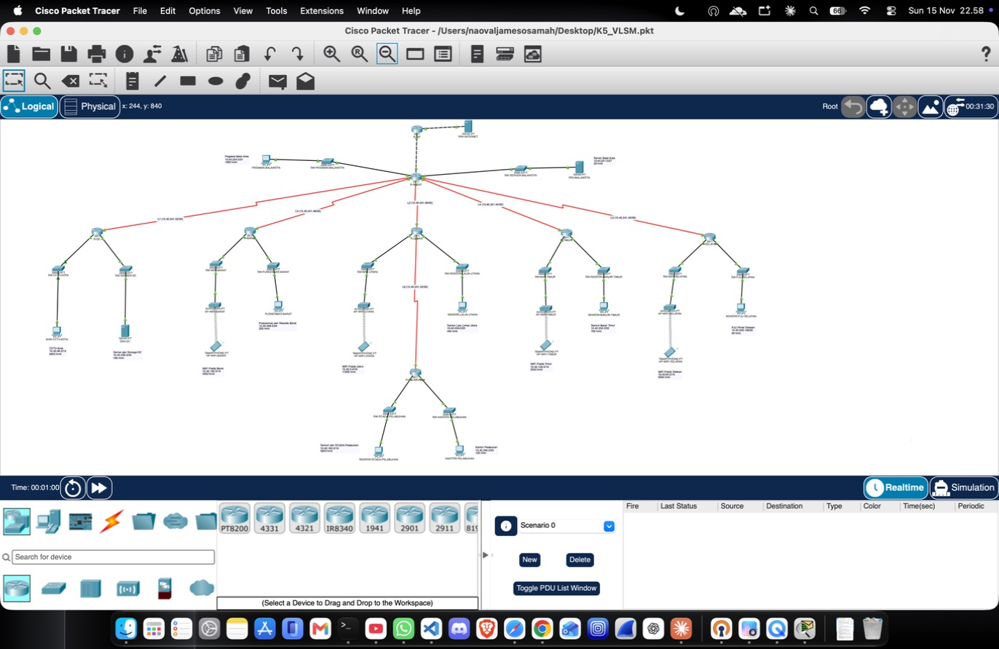

**Soal 1 – Topologi dengan penanda LAN**: setiap lingkaran menandai satu LAN (satu subnet) beserta prefix-nya, supaya pembagian 14 subnet VLSM mudah dilihat.


**Soal 3 & 5 – R-PUSAT:** `show ip nat translations` (10.40.224.11 diterjemahkan ke 203.0.113.21) dan `show ip route static` (13 static route + default ke R-ISP)

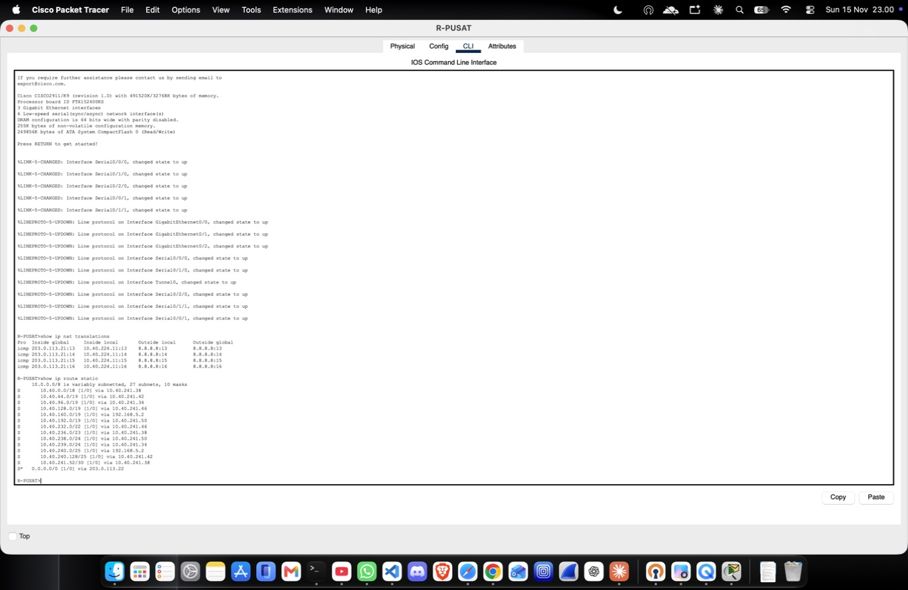

**Soal 3 & 5 – PEGAWAI-BALAIKOTA:** ping ke SENSOR-SCADA-PELABUHAN (10.40.160.11), SENSOR-PJU-SELATAN (10.40.240.139), dan SRV-INTERNET (8.8.8.8)

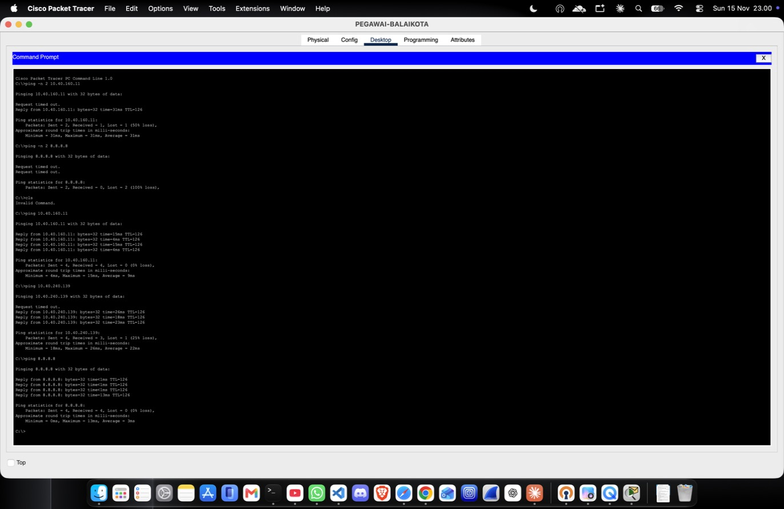

**Soal 4 – NVR-CCTV-KOTA:** `ipconfig /renew` dan `ipconfig /all`, DHCP Servers 10.40.239.10 (SRV-DC lewat helper-address)

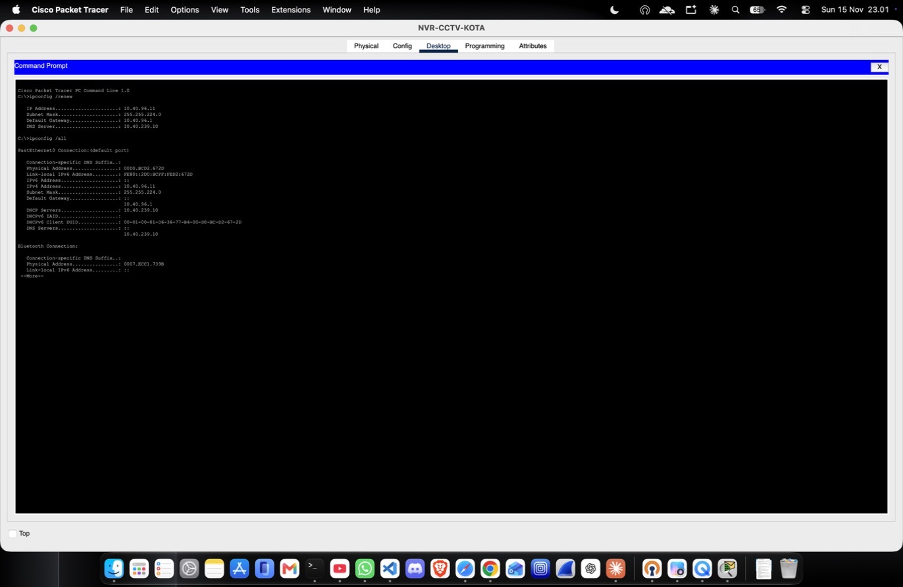

**Soal 5 – R-ISP:** `show ip route` tanpa rute ke alamat privat 10.x

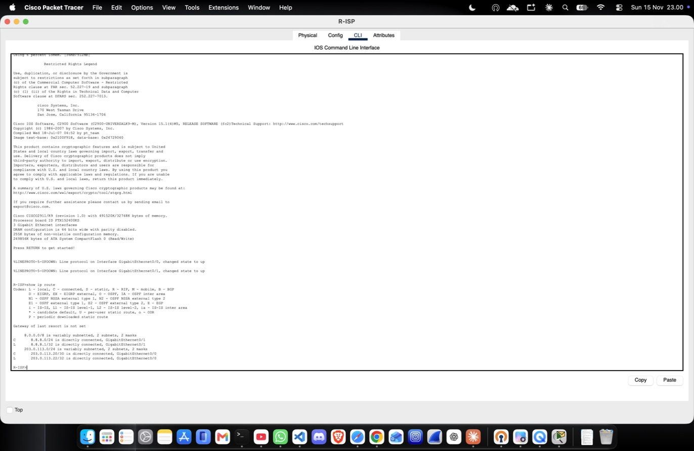

**Soal 6 & 8a – PEGAWAI-BALAIKOTA:** `tracert 10.40.240.11` lewat 192.168.5.2 (tunnel) dan `nslookup` www/ftp/mail

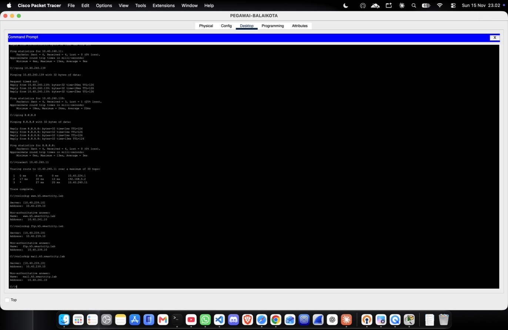

**Soal 7 – R-DC:** `show ip ospf neighbor` (FULL) dan `show ip route ospf` (O dan O*E2)

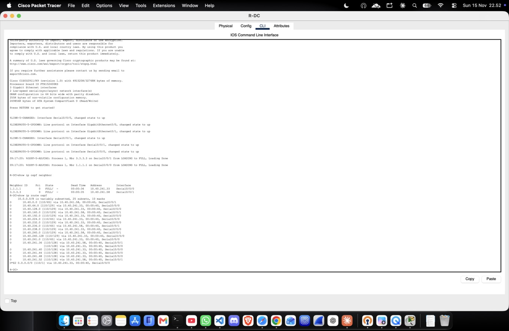

**Soal 7 – NVR-CCTV-KOTA:** tracert sebelum (via 10.40.241.33/L1), `ping -t` saat L1 diputus (1× RTO, TTL 125 → 124), tracert sesudah (via 10.40.241.58/L7)

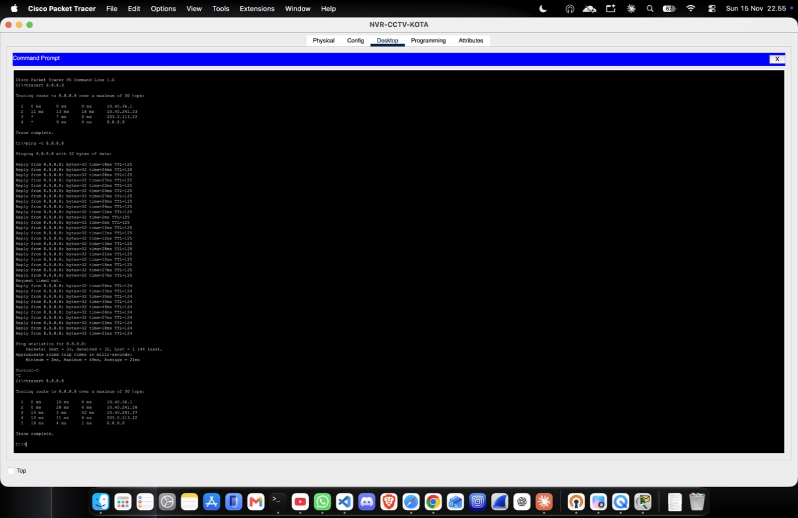

**Soal 8b – Portal web** dari PEGAWAI-BALAIKOTA dengan nama domain

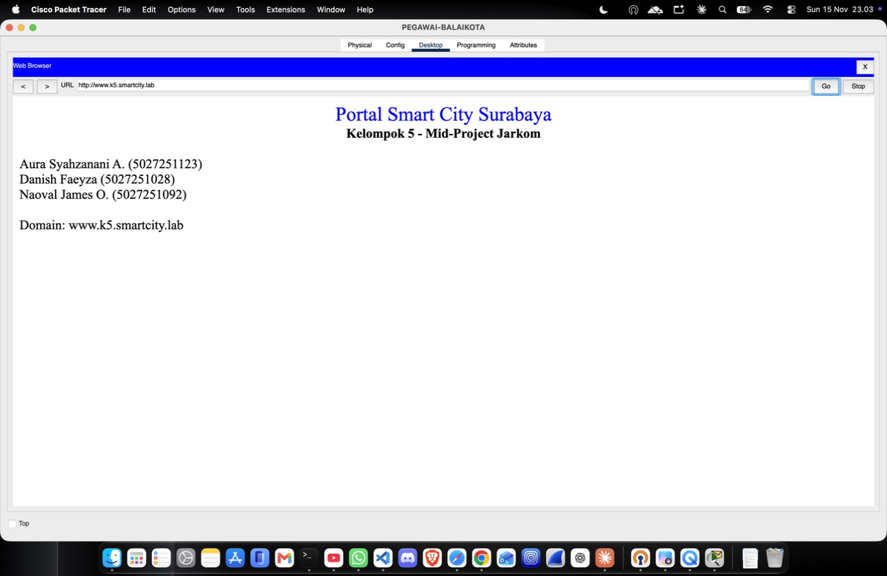

**Soal 8c – FTP** dari NVR-CCTV-KOTA: login `cctv`, `put rekaman-cctv.txt`

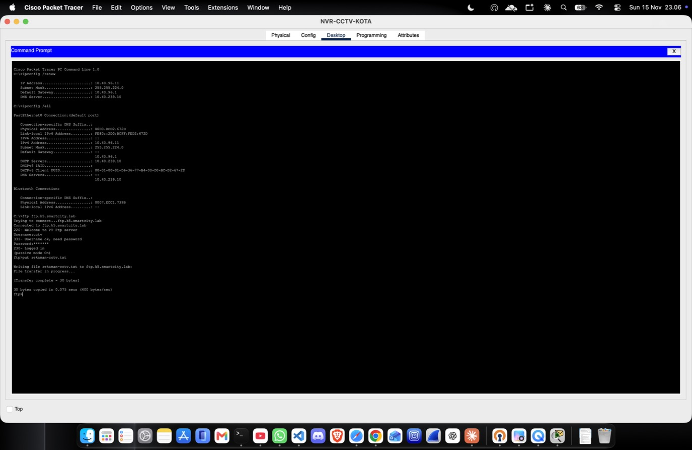

**Soal 8d – Email** diterima KANTOR-PELABUHAN dari pegawai@k5.smartcity.lab

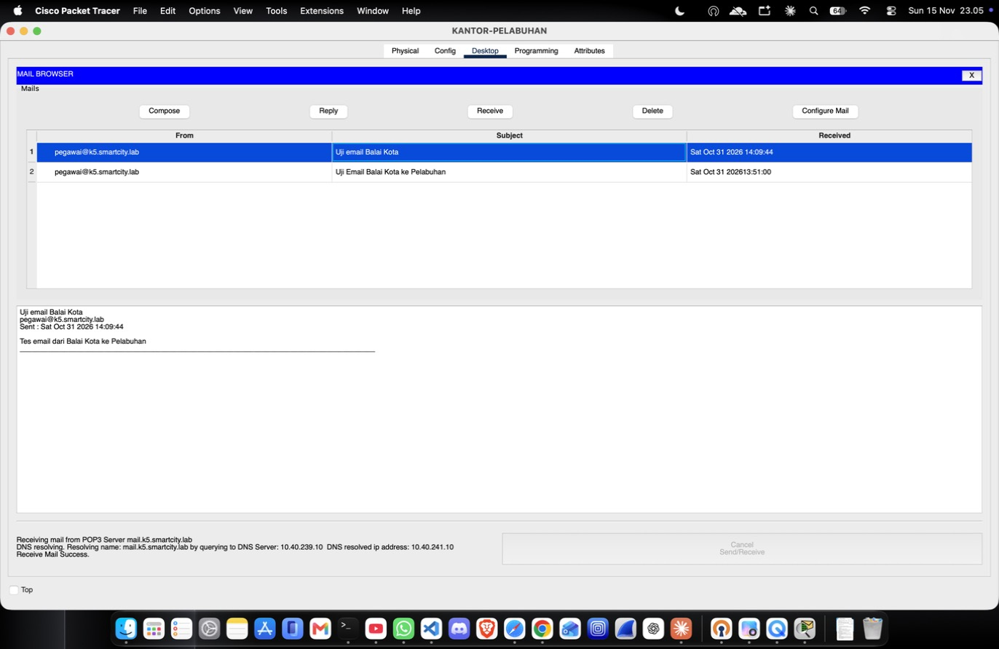
